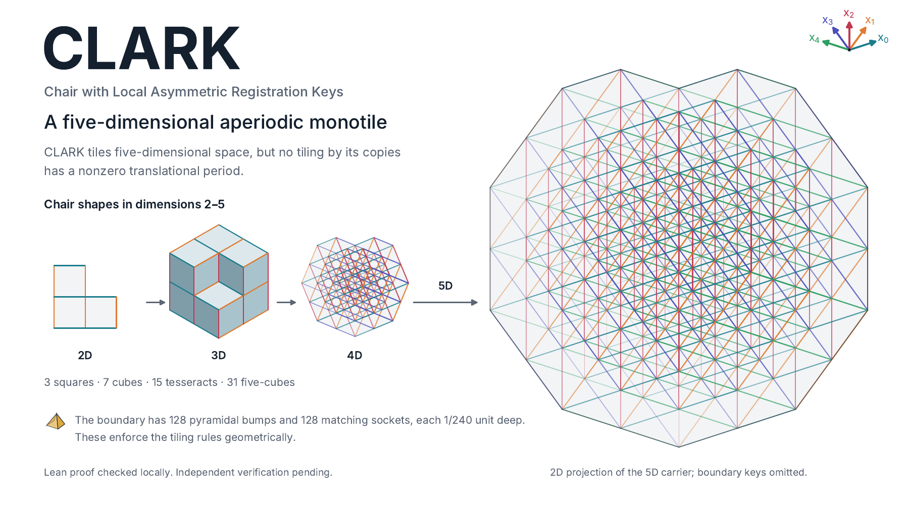

# Aperiodic monotiles in every dimension d ≥ 2

Conor Grogan, author and responsible maintainer

We construct one tile shape for each Euclidean dimension d ≥ 2. Copies of that shape can fill space without gaps or overlapping interiors, but no tiling made from them repeats after a nonzero translation (a slide without rotation). Such a shape is an aperiodic monotile. Copies may be rotated or reflected, and the shape may differ between dimensions.

[Read the current paper: Aperiodic Monotiles in Every Dimension (22 October 2026, PDF)](papers/all-dimensions/aperiodic-monotiles-every-dimension-2026-10-22.pdf)

JACKIE (Joined Aperiodic Cartesian Keyed Interlocking Einstein) is the four-dimensional construction: a product of two planar polygonal shapes with 56 pyramidal keys, geometric features that enforce how copies fit together. It is the exact tile used for d = 4 in the all-dimensional proof, separate from the earlier odd-prime construction family. See the [exact body](https://github.com/jconorgrogan/palomar-chair-verification/blob/048bb245b60abce79f1a2d0c82336ff8508ec752/src/SpectreGeometry/PolygonProductKeyBody.lean#L24-L26), [four-dimensional proof](https://github.com/jconorgrogan/palomar-chair-verification/blob/048bb245b60abce79f1a2d0c82336ff8508ec752/src/NativeFinalAssembly/KeyedProductOfParent.lean#L16-L30), and [selected d = 4 branch](https://github.com/jconorgrogan/palomar-chair-verification/blob/048bb245b60abce79f1a2d0c82336ff8508ec752/src/NativeFinalAssembly/AllDimensionsOfParent.lean#L26-L29).

CLARK stands for Chair with Local Asymmetric Registration Keys. It is the original five-dimensional construction, separately [registered in Palomar as PALOMAR-2026-10-07-000006 v1](https://palomar-registry.org/entry?id=PALOMAR-2026-10-07-000006&version=1). Palomar is the independent verification registry used for this project. CLARK's [registered proof](https://github.com/jconorgrogan/palomar-chair-verification/blob/5f5ceedee770b76c21e8f1105e5e4e3b84b8d676/Solution.lean) also shows that every tiling has at most 3,840 Euclidean symmetries: motions, including reflections, that preserve the entire arrangement of tiles.

The [all-dimensional translation-aperiodicity proof](https://github.com/jconorgrogan/palomar-chair-verification/blob/048bb245b60abce79f1a2d0c82336ff8508ec752/src/PalomarAllDimensionsSolution.lean#L19-L41), including JACKIE, has compiled in Lean, a computer proof assistant. Lean accepted the formal proof, but the additional independent Palomar checks have not finished. The [official verification run](https://github.com/jconorgrogan/palomar-chair-verification/actions/runs/39294694136) reached its 19,800-second (5½-hour) worker limit; statement/definition comparison, external proof-checker checks, and the final theorem's axiom audit remain unfinished. Whether those checks will pass is unknown. CLARK's separate verification and registration are complete.

The paper also gives a stronger written finite-symmetry argument for d > 2. That extension has received an AI mathematical/source review, but has not yet been implemented in Lean or independently verified. See [Finite full symmetry](#finite-full-symmetry) for its exact scope.

[Construction and proof](#construction-and-proof) · [Finite full symmetry](#finite-full-symmetry) · [Papers](#papers) · [Verification evidence](#verification-evidence) · [Reproduction](#reproduction) · [Verification history](#verification-history) · [Attribution and AI use](#attribution-production-and-license)

## Construction and proof

A physical tiling is a collection of isometric copies of the tile (copies moved, rotated, or reflected without changing size or shape) that covers Euclidean space and has disjoint interiors for distinct tile sets. A translational period must preserve the arrangement of individual tiles, not merely the space they cover. No underlying grid (lattice registration), added matching labels, restriction on orientation, or preassigned hierarchy of larger patches is assumed: the tile's geometry must enforce the required structure.

For every integer d ≥ 2, the [compiled Lean theorem](https://github.com/jconorgrogan/palomar-chair-verification/blob/048bb245b60abce79f1a2d0c82336ff8508ec752/src/PalomarAllDimensionsSolution.lean#L19-L41) gives a compact tile with nonempty interior, at least one physical tiling, and no nonzero translational period in any physical tiling. Here, compact means closed and bounded; nonempty interior rules out a tile made only of lower-dimensional surfaces.

### JACKIE and the four-dimensional branch

JACKIE is the keyed product of two planar polygonal carriers, the underlying shapes before keys are added. Combining the two planar factors gives a four-dimensional body, defined in Lean as `SpectreGeometry.polygonProductKeyBody`. Its 56 pyramidal keys enforce the structure used in the physical tiling proof.

Earlier versions made a helper result called the parent-occurrence premise C an explicit assumption. C is now [proved and supplied internally](https://github.com/jconorgrogan/palomar-chair-verification/blob/048bb245b60abce79f1a2d0c82336ff8508ec752/src/NativeFinalAssembly/AllDimensions.lean#L16-L23). It remains an input to intermediate modules, but is no longer a premise of the final all-dimensional theorem.

The Lean proof uses these modules:

1. [KeyedProductOfParent.lean](https://github.com/jconorgrogan/palomar-chair-verification/blob/048bb245b60abce79f1a2d0c82336ff8508ec752/src/NativeFinalAssembly/KeyedProductOfParent.lean) supplies the four-dimensional theorem with the parent-occurrence premise C.
2. [RadiusFivePruningHierarchy.lean](https://github.com/jconorgrogan/palomar-chair-verification/blob/048bb245b60abce79f1a2d0c82336ff8508ec752/src/SpectreFinite/RadiusFivePruningHierarchy.lean#L11-L16) proves C as `certifiedParentOccurrenceTheorem`.
3. [AllDimensionsOfParent.lean](https://github.com/jconorgrogan/palomar-chair-verification/blob/048bb245b60abce79f1a2d0c82336ff8508ec752/src/NativeFinalAssembly/AllDimensionsOfParent.lean#L18-L30) selects JACKIE in dimension four, and [AllDimensions.lean](https://github.com/jconorgrogan/palomar-chair-verification/blob/048bb245b60abce79f1a2d0c82336ff8508ec752/src/NativeFinalAssembly/AllDimensions.lean#L16-L23) supplies the proved C theorem to the assembly.
4. [PalomarAllDimensionsSolution.lean](https://github.com/jconorgrogan/palomar-chair-verification/blob/048bb245b60abce79f1a2d0c82336ff8508ec752/src/PalomarAllDimensionsSolution.lean#L36-L41) exposes the resulting theorem with only d and 2 ≤ d as arguments.

A separate source-level geometric and exact-arithmetic review counts 362 connected flat three-dimensional boundary pieces for JACKIE. This is a count of pieces of the full boundary, not a count of matching keys. The claim that this exact body is polyhedral, and the count of its boundary pieces, are not completed Lean theorems and are not part of the selected all-dimensional theorem.

### The other dimensions

The proof uses the exact curved planar body in dimension two and a repeatable keyed-product construction in dimension three and every dimension at least five. Called the “compiler” in the source, this construction combines lower-dimensional tiles to obtain higher-dimensional ones, rebuilding their geometric registration keys while preserving tiling existence and aperiodicity in every tiling. See the [dimension-addition proof](https://github.com/jconorgrogan/palomar-chair-verification/blob/048bb245b60abce79f1a2d0c82336ff8508ec752/src/ProductClosure/ProductDimensions.lean), [three-dimensional seed](https://github.com/jconorgrogan/palomar-chair-verification/blob/048bb245b60abce79f1a2d0c82336ff8508ec752/src/ProductClosure/CertifiedDimensions.lean), and [coverage of every dimension at least five](https://github.com/jconorgrogan/palomar-chair-verification/blob/048bb245b60abce79f1a2d0c82336ff8508ec752/src/ClarkSeed/PhysicalDimensions.lean#L23-L55).

The compiler starts from specific bodies called seeds. Its five-dimensional seed is a newly generated body derived from CLARK proof data; it has not been identified with the CLARK tile registered in Palomar. Likewise, its seven-dimensional seed has not been identified with HENRY, the earlier seven-dimensional construction. These are separate verification targets; CLARK's registration does not by itself verify the all-dimensional result.

### CLARK and its registered theorem

CLARK is the original sparse five-dimensional body, called `T5` in the Lean code.



This is a two-dimensional slice through a patch of the five-dimensional construction, not a picture of the full tile. The main panel shows sections of the underlying carriers. The geometric matching keys become visible in the 12× and 690× zooms of the same plane. Colours count negative coordinate signs; all displayed full frames preserve orientation. The small target ring is enlarged 2.2× for visibility. See [figure details and the sections/key diagrams](figures/README.md).

The tile starts with a chair-shaped arrangement of 31 unit five-dimensional cubes, then modifies it with 256 rational pyramidal keys (keys specified by exact rational coordinates). Translated, rotated, and reflected copies are allowed. The Lean theorem proves that this exact body is compact, admits a physical tiling, and has no nonzero translational period in any such tiling, without assuming lattice registration or matching rules. Every tiling also has a finite full Euclidean symmetry group of at most 3,840 elements. Here, strongly aperiodic means finite full symmetry group; a trivial symmetry group is not asserted. See the [exact tile definition](https://github.com/jconorgrogan/palomar-chair-verification/blob/5f5ceedee770b76c21e8f1105e5e4e3b84b8d676/Challenge.lean), the [selected theorem proof](https://github.com/jconorgrogan/palomar-chair-verification/blob/5f5ceedee770b76c21e8f1105e5e4e3b84b8d676/Solution.lean), and the [complete physical monotile theorem](https://github.com/jconorgrogan/palomar-chair-verification/blob/5f5ceedee770b76c21e8f1105e5e4e3b84b8d676/SparseMonotiles/T5Monotile.lean).

## Finite full symmetry

Translation aperiodicity rules out a tiling that repeats after a slide. The full Euclidean symmetry group also includes rotations, reflections, and combinations of these with translations. A finite full symmetry group allows only finitely many such motions that preserve the tiling; it need not contain only the identity motion.

The mathematical extension dated 22 October 2026 uses existing source lemmas to prove that the constructed monotiles in every integer dimension d > 2 have finite full Euclidean symmetry groups in every admitted tiling. This excludes all infinite-order screw and glide symmetries; it does not assert trivial symmetry groups. For the tiles produced by the compiler in d = 3 and d ≥ 5, the argument gives |Sym(T)| ≤ 2^d d!, where Sym(T) is the symmetry group of a tiling T and d! is the factorial of d. Dimension 4 uses a separate planar-factor argument; no numerical bound is claimed for that branch.

The argument has received a separate AI mathematical/source review. The new finite-symmetry deductions and stronger combined theorem have not been implemented in Lean, compiled, independently kernel-checked, or registered in Palomar.

[Read the mathematical extension](papers/FINITE_SYMMETRY_EXTENSION_2026-10-22.md) · [Read the AI source review and its limits](papers/FINITE_SYMMETRY_SOURCE_REVIEW_2026-10-22.md)

## Papers

- Current all-dimensional paper, 22 October 2026: [Aperiodic Monotiles in Every Dimension (PDF)](papers/all-dimensions/aperiodic-monotiles-every-dimension-2026-10-22.pdf), [Word](papers/all-dimensions/aperiodic-monotiles-every-dimension-2026-10-22.docx), [editable text](papers/all-dimensions/aperiodic-monotiles-every-dimension-2026-10-22.md), and [manuscript source and document-generation files (ZIP)](papers/all-dimensions/aperiodic-monotiles-every-dimension-2026-10-22-source.zip). It covers the compiled Lean result, JACKIE, and the mathematical finite-symmetry proof. This revision has no new Zenodo archive version or digital object identifier (DOI).
- Archived all-dimensional working paper, 16 October 2026 snapshot: [PDF](papers/all-dimensions-working/aperiodic-monotiles-every-dimension-working-v1.pdf), [Word](papers/all-dimensions-working/aperiodic-monotiles-every-dimension-working-v1.docx), [editable text](papers/all-dimensions-working/aperiodic-monotiles-every-dimension-working-v1.md), and [dated claim scope](papers/all-dimensions-working/README.md). Its pending-C and pending-uniform-theorem statements predate the successful build and proof exports.
- Finite full symmetry in every dimension d > 2, 22 October 2026: [mathematical extension](papers/FINITE_SYMMETRY_EXTENSION_2026-10-22.md) and [separate AI mathematical/source review](papers/FINITE_SYMMETRY_SOURCE_REVIEW_2026-10-22.md). The stronger endpoint is not implemented in Lean.
- Earlier CLARK/HENRY and odd-prime paper: [An Arithmetic Family of Aperiodic Tilings in Odd Prime Dimensions, version 2 (PDF)](CLARK_paper.pdf?raw=1), [Zenodo record 23197680](https://zenodo.org/records/23197680), DOI [10.5281/zenodo.23197680](https://doi.org/10.5281/zenodo.23197680). The [Citation File Format (CFF)](CITATION.cff) and [BibTeX](CITATION.bib) citation files, and the Zenodo digital object identifier (DOI), refer to this earlier paper, not the current all-dimensional revision.

The earlier paper gives a written computer-assisted proof for the sparse seven-dimensional HENRY body and a hierarchy theorem for chair matching rules with geometric registration in every odd-prime dimension. Complete Lean verification of that exact HENRY body remains unfinished. The [historical mathematical account](https://github.com/jconorgrogan/palomar-chair-verification/blob/9008dec3afc006a62d3d2fd6b49b12f189248f33/README.md#broader-program) describes those results.

## Verification evidence

The verification pipeline checks more than whether the Lean source compiles. The Challenge states the exact claim independently; the Solution supplies the proof. The Comparator checks that the statement and definitions proved by Solution match Challenge. Additional proof-checking kernels check the exported proof, and an axiom audit lists the assumptions on which the final theorem depends. Lake is Lean's build tool; counts of Lake jobs describe build work, not numbers of mathematical theorems.

The all-dimensional source, including JACKIE, is frozen at [`048bb245b60abce79f1a2d0c82336ff8508ec752`](https://github.com/jconorgrogan/palomar-chair-verification/tree/048bb245b60abce79f1a2d0c82336ff8508ec752). The [independent Challenge](https://github.com/jconorgrogan/palomar-chair-verification/blob/048bb245b60abce79f1a2d0c82336ff8508ec752/src/PalomarAllDimensionsChallenge.lean) fixes the physical statement; the [Solution](https://github.com/jconorgrogan/palomar-chair-verification/blob/048bb245b60abce79f1a2d0c82336ff8508ec752/src/PalomarAllDimensionsSolution.lean) proves it without importing Challenge. Challenge intentionally leaves its proof slot empty because it specifies what must be proved; the actual proof is in Solution. This placeholder is not a missing step in the Solution proof.

The [official full preflight run 39294694136](https://github.com/jconorgrogan/palomar-chair-verification/actions/runs/39294694136) used Lean 4.35.0-rc2, the official reusable workflow pinned at `d4e41c1d5b0d114c4859e6e5831dc6d3ad1d0d44`, and the `palomar-standard-v1` profile. It records:

- `solution-build`: exit 0, 12,476 Lake jobs, 12,190.542 seconds.
- `challenge-export`: exit 0, 9.374 seconds.
- `solution-export`: exit 0, 72.796 seconds.
- Overall report: `status: error`, `stage: resource-exhausted`; Comparator was the last active stage when the shared 19,800-second worker budget ran out.

The final statement/definition comparison, external-kernel verification, and final-endpoint axiom audit remain unfinished. The existing axiom output covers helper C only, not the final all-dimensional theorem. The run retained no resumable build/export checkpoint. Whether the remaining checks will pass is still unknown.

See the [verification note](verification/ALL_DIMENSIONS_STATUS_2026-10-20.md), [mechanical report](verification/ALL_DIMENSIONS_MECHANICAL_REPORT_39294694136.json), and [original report artifact](https://github.com/jconorgrogan/palomar-chair-verification/actions/runs/39294694136/artifacts/12227932621). The report mirror's SHA-256 is `a1681ef51911a64f4bfe975e283396cd7ef3f8f4fd2aac5130ecdd3c5ef23ec6`.

### CLARK verification

CLARK was [registered in Palomar as PALOMAR-2026-10-07-000006 v1](https://palomar-registry.org/entry?id=PALOMAR-2026-10-07-000006&version=1) on 7 October 2026. The registered result is `PalomarMonotiles.T5_strongAperiodicity` at immutable source commit `5f5ceedee770b76c21e8f1105e5e4e3b84b8d676`. The registry records successful mechanical verification and an automated review with no problems identified.

The selected theorem, independent Challenge, Solution and axiom audit passed local Lean 4.35.0-rc2 checks. The whole statement-definition comparison passed with no exemptions. The audited theorem depends only on `propext`, `Classical.choice`, and `Quot.sound`. The [extension evidence](https://github.com/jconorgrogan/palomar-chair-verification/blob/5f5ceedee770b76c21e8f1105e5e4e3b84b8d676/verification/STRONG_EXTENSION.md) records these local checks and their scope.

The [official full Palomar mechanical preflight passed](https://github.com/jconorgrogan/palomar-chair-verification/actions/runs/37544058631) for immutable source commit `5f5ceedee770b76c21e8f1105e5e4e3b84b8d676`. Lean's default kernel, NanoDa and verified con-ron all accepted the Solution; con-ron checked 69,558 declarations. The clean build completed 4,137 Lake jobs, and the source audit checked 1,357 Lean files. The [full mechanical report](verification/STRONG_MECHANICAL_REPORT_37544058631.json) records `status: pass`, `stage: complete`, and no errors or warnings. The [verification receipt](verification/STRONG_PREFLIGHT_PASS_37544058631.json) binds the source, report and checker results; the [original GitHub artifact](https://github.com/jconorgrogan/palomar-chair-verification/actions/runs/37544058631/artifacts/11454083416) remains available. Report JSON SHA-256: `82711b9d865e0441d453decdfebf5b4d071292f46b52a5e5ca77c385ed498884`.

The run used the reusable workflow pinned at `d4e41c1d5b0d114c4859e6e5831dc6d3ad1d0d44` under `palomar-standard-v1`, with no definition exemptions. The selected statement, `T5StrongClaim`, includes the 3,840 symmetry bound and the original compactness, tiling-existence and translation-aperiodicity claim as a conjunct. The independent Challenge fixes the exact shape and physical statement; Solution proves it without importing Challenge.

The complete stronger source is on [the T5 verification branch](https://github.com/jconorgrogan/palomar-chair-verification/tree/verification/palomar-strong1-20261006), frozen at commit [`5f5ceedee770b76c21e8f1105e5e4e3b84b8d676`](https://github.com/jconorgrogan/palomar-chair-verification/tree/5f5ceedee770b76c21e8f1105e5e4e3b84b8d676).

- [Full mathematical account and reproduction instructions](https://github.com/jconorgrogan/palomar-chair-verification/blob/5f5ceedee770b76c21e8f1105e5e4e3b84b8d676/README.md)
- [Finite full-symmetry proof](https://github.com/jconorgrogan/palomar-chair-verification/blob/5f5ceedee770b76c21e8f1105e5e4e3b84b8d676/SparseMonotiles/FiniteSymmetry.lean)
- [Independent Challenge](https://github.com/jconorgrogan/palomar-chair-verification/blob/5f5ceedee770b76c21e8f1105e5e4e3b84b8d676/Challenge.lean) and [actual Solution](https://github.com/jconorgrogan/palomar-chair-verification/blob/5f5ceedee770b76c21e8f1105e5e4e3b84b8d676/Solution.lean)
- [Structured metadata, source relationships, automation and review account](https://github.com/jconorgrogan/palomar-chair-verification/blob/5f5ceedee770b76c21e8f1105e5e4e3b84b8d676/formalization.yaml)
- [Exact source manifest](https://github.com/jconorgrogan/palomar-chair-verification/blob/5f5ceedee770b76c21e8f1105e5e4e3b84b8d676/SOURCE_MANIFEST.json)
- [Verification runs](https://github.com/jconorgrogan/palomar-chair-verification/actions)

The source manifest has SHA-256 `ec0ed3ed9927fe13aa654c713ce9eb83e2a52da7b3d6c6c6cea07efcebb998f3`. The snapshot contains the full proof development. The `main` branch is the public index and retains the earlier history.

## Reproduction

Use the pinned source snapshots below rather than treating the repository’s current `main` branch as the verification snapshot. There are two separate targets: the compiled all-dimensional theorem, whose independent checks are unfinished, and the fully registered CLARK theorem.

[Download the complete pinned all-dimensional source ZIP](https://github.com/jconorgrogan/palomar-chair-verification/archive/048bb245b60abce79f1a2d0c82336ff8508ec752.zip). The immutable snapshot includes the [Lean toolchain pin](https://github.com/jconorgrogan/palomar-chair-verification/blob/048bb245b60abce79f1a2d0c82336ff8508ec752/lean-toolchain), [Lake configuration](https://github.com/jconorgrogan/palomar-chair-verification/blob/048bb245b60abce79f1a2d0c82336ff8508ec752/lakefile.lean), [dependency manifest](https://github.com/jconorgrogan/palomar-chair-verification/blob/048bb245b60abce79f1a2d0c82336ff8508ec752/lake-manifest.json), [Comparator selection](https://github.com/jconorgrogan/palomar-chair-verification/blob/048bb245b60abce79f1a2d0c82336ff8508ec752/comparator.json), and [formalization metadata](https://github.com/jconorgrogan/palomar-chair-verification/blob/048bb245b60abce79f1a2d0c82336ff8508ec752/formalization.yaml). The selected Solution module is `PalomarAllDimensionsSolution`. The frozen source's "unexecuted" comments predate the successful build in run 39294694136.

For independent verification, use the [pinned official pipeline](https://github.com/PalomarRegistry/PalomarSubmission/tree/d4e41c1d5b0d114c4859e6e5831dc6d3ad1d0d44) and preserve the exact Challenge, Solution, dependency pins, and physical definitions. The independent checks still need to finish on a supported route with sufficient compute.

### Reproduce the registered CLARK source

[Download the complete pinned source ZIP](https://github.com/jconorgrogan/palomar-chair-verification/archive/5f5ceedee770b76c21e8f1105e5e4e3b84b8d676.zip).

Use a Linux host meeting the official standard-profile floor: at least 14 GiB RAM and 20 GiB free disk. Install Bash, Git, Python 3, curl 7.81 or newer with working TLS/network access, standard Unix utilities, and Bubblewrap with usable namespaces. The sandbox expects `/root`, `/home` and `/run/user` to exist. Use the official prebuilt Lean 4.35.0-rc2 toolchain (directly or through Elan), with `lean`, `lake`, `leanexport`, `leanchecker`, `nanoda_bin`, `con-ron` and `leantar` available from that toolchain. Rust, Cargo and CMake are not required for this prebuilt route.

From a directory without an existing `clark-replay` folder, run:

```sh
COMMIT=5f5ceedee770b76c21e8f1105e5e4e3b84b8d676; git clone https://github.com/jconorgrogan/palomar-chair-verification.git clark-replay && cd clark-replay && git checkout --detach "$COMMIT" && bash scripts/verify-t5-on-linux.sh
```

The script checks the exact source manifest, builds the selected proof and runs the bundled Comparator with Lean, NanoDa and verified con-ron. It requires Bubblewrap namespaces and can take an hour or more. This reproduces the proof, Comparator and kernel checks. The full Palomar workflow also checks metadata, Challenge provenance, execution-profile limits and its mechanical report.

## Verification history

The original CLARK theorem's [official full Palomar mechanical preflight passed](https://github.com/jconorgrogan/palomar-chair-verification/actions/runs/37520435323) for immutable source commit `9008dec3afc006a62d3d2fd6b49b12f189248f33`. The selected original T5 theorem covers compactness, tiling existence and no nonzero translation period in any physical tiling. Lean's default kernel, NanoDa and verified con-ron all accepted the Solution; con-ron checked 69,348 declarations. The [mechanical report artifact](https://github.com/jconorgrogan/palomar-chair-verification/actions/runs/37520435323/artifacts/11444507885) records `status: pass`, `stage: complete`, and no errors or warnings. The report JSON has SHA-256 `43edc2c785ceaa7ecff4b231a0a9738a5e320d6fd5b0461d6de88491f482f027`. This run used the full pinned reusable workflow under `palomar-standard-v1` for the original theorem, before the finite-symmetry extension. The registered version is the stronger snapshot cited above.

The [first full run](https://github.com/jconorgrogan/palomar-chair-verification/actions/runs/37509737027) clean-built all 4,135 Lake jobs but rejected a generated statement-helper proof before the independent main kernels. The repair replaced only two bound-proof blocks with explicit terms; the complete helper function is definitionally unchanged. Local whole-statement dependency comparison and affected-binding/Solution checks passed before the successful official retry. The [repair evidence](https://github.com/jconorgrogan/palomar-chair-verification/blob/9008dec3afc006a62d3d2fd6b49b12f189248f33/verification/COMPARATOR_REPAIR.md) records the changes and checks.

An [earlier four-result compatibility pilot](https://github.com/jconorgrogan/palomar-chair-verification/actions/runs/37466588417) passed the official Comparator and three kernels. That pilot checked four supporting statements, not the full T5 theorem.

### All-dimensional milestones

- 16 October 2026: the working paper recorded accepted native two- and four-dimensional results with C explicit, plus unconditional verification for dimension three and every dimension at least five. The [dated manuscript](papers/all-dimensions-working/aperiodic-monotiles-every-dimension-working-v1.md) records that stage of the work.
- 19 October 2026: the selected all-dimensional Solution built and both proof exports succeeded in [run 39294694136](https://github.com/jconorgrogan/palomar-chair-verification/actions/runs/39294694136); the remaining independent verification exhausted the worker budget. The [20 October verification note](verification/ALL_DIMENSIONS_STATUS_2026-10-20.md) reconciles the newer source and run with older metadata.
- 22 October 2026: the [revised all-dimensional manuscript](papers/all-dimensions/aperiodic-monotiles-every-dimension-2026-10-22.pdf) contains the construction, compiled translation-aperiodicity result, and mathematical finite-symmetry proof. The [finite-full-symmetry extension](papers/FINITE_SYMMETRY_EXTENSION_2026-10-22.md) and [AI source review](papers/FINITE_SYMMETRY_SOURCE_REVIEW_2026-10-22.md) give the argument and identify the Lean lemmas still to implement.

The [clean hierarchy-C campaign](https://github.com/jconorgrogan/palomar-chair-verification/actions/runs/39179019728), [174-module visibility test](https://github.com/jconorgrogan/palomar-chair-verification/actions/runs/39265576764), and [388-module import-optimization test](https://github.com/jconorgrogan/palomar-chair-verification/actions/runs/39279478084) are supporting checks; none completed the final all-dimensional verification.

## Attribution, production, and license

Adam Scherlis previously formulated the all-dimensional keyed-product program, including the four-dimensional construction and 56-key count, in his [pinned primary note](https://github.com/AdamScherlis/adamscherlis.github.io/blob/e05cee7245124a705ca68be3a8f641d290c664b4/static/monotiles-every-dimension/index.html). No priority is claimed here for that general idea, four-dimensional idea, count, or all-dimension formulation. Attribution is separate from verification of any particular argument.

AI systems made substantive contributions to mathematical analysis, Lean proofs, exact certificate generation, audits, migration and exposition. The metadata records those contributions separately from human authorship. No independent human mathematical peer review or novelty certification is claimed.

The companion preprint (`CLARK_paper.pdf`) and its figures are licensed under [Creative Commons Attribution 4.0 International (CC BY 4.0)](https://creativecommons.org/licenses/by/4.0/). The proof code is licensed under [Apache License 2.0](https://github.com/jconorgrogan/palomar-chair-verification/blob/9008dec3afc006a62d3d2fd6b49b12f189248f33/LICENSE). Lean, Mathlib and other dependencies retain their own licenses and notices.


